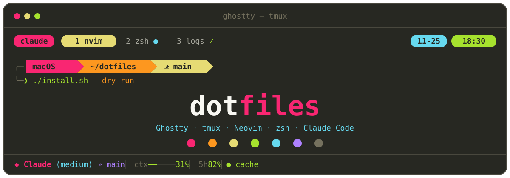

<p align="center">
  
</p>

<p align="center">
  
  
  
  
</p>

My everyday terminal on macOS: one Monokai palette from the window chrome down to the git diff,
with [Claude Code](https://claude.com/claude-code) living inside tmux. Clone it, run one script,
and a fresh Mac looks and behaves like mine.

## ✨ What's inside

| Layer | Tool | Highlights |
| --- | --- | --- |
| Terminal | [Ghostty](https://ghostty.org) | Translucent blurred window, cursor-warp shader, quick terminal, custom flat ghost icon |
| | iTerm2 | Matching `Monokai` dynamic profile |
| Multiplexer | tmux | Pill-style status bar, popups for lazygit / btop / yazi, session restore, **Claude status badges** |
| Shell | zsh + Oh My Zsh | fzf-tab previews, autosuggestions, syntax highlighting, transient prompt, lazy conda |
| Prompt | [Starship](https://starship.rs) | Powerline segments in the Monokai palette |
| Editor | Neovim ([LazyVim](https://lazyvim.org)) | Monokai Pro, VS Code-style keys, claudecode.nvim, smear cursor, Python and LaTeX setup |
| AI | Claude Code | Custom theme, one-line status bar with quota and cache state, tmux hooks, LSP plugins |
| CLI | eza · bat · fd · ripgrep · fzf · zoxide · atuin · yazi · television · btop · fastfetch | Monokai wherever the tool allows it |
| Git | delta · lazygit · gh-dash | Monokai diffs everywhere |
| Extras | Karabiner-Elements · JankyBorders (optional) | `「」` on `Shift+[` / `Shift+]` with WeType |

## 🚀 Restore

You need an Apple Silicon Mac, the Xcode Command Line Tools (`xcode-select --install`) and
[Homebrew](https://brew.sh).

```bash
git clone https://github.com/ClarkeLi/dotfiles.git ~/dotfiles
cd ~/dotfiles
./install.sh --dry-run   # see what would happen
./install.sh             # do it
```

The script is safe to re-run. It:

1. installs everything in the [`Brewfile`](Brewfile),
2. clones Oh My Zsh, the zsh plugins and the tmux plugins at the commits in [`versions.lock`](versions.lock),
3. copies [`home/`](home) into `$HOME`, moving anything it would replace to `~/.dotfiles-backup/<timestamp>/`,
4. sets up Claude Code and its plugins, `gh-dash`, [Lumen](https://github.com/ClarkeLi/Lumen) and the Neovim plugins from `lazy-lock.json`.

Only want the config files? `./install.sh --files-only`

### After installing

- Reopen Ghostty and type `t` to enter the tmux session.
- Allow Ghostty under *Privacy & Security → Accessibility* for the global ``Ctrl+` `` quick terminal.
- Sign in where needed: `claude`, `gh auth login`, and `:Copilot auth` inside Neovim.
- Put machine-specific or private shell settings in `~/.zshrc.local`; it is sourced but never tracked.

> [!WARNING]
> These are personal settings. Before using them yourself:
> - [`.gitconfig`](home/.gitconfig) and [`.claude/CLAUDE.md`](home/.claude/CLAUDE.md) carry **my** git identity. Change it to yours.
> - Claude Code is configured with `skipDangerousModePermissionPrompt`, and tmux restores sessions that were
>   started with `--dangerously-skip-permissions`. Remove both unless you really want that.
> - The Claude interface language is set to `zh.SG`, and many comments are in Chinese.

## ⌨️ Cheat sheet

<details open>
<summary><b>tmux</b> (prefix <code>Ctrl+b</code>)</summary>

| Keys | Action |
| --- | --- |
| `prefix` `\|` / `-` | Split right / down |
| `Alt` `h j k l` | Move between panes, no prefix |
| `Alt+n`, `Alt+1…5` | New window, jump to window |
| `Alt+z` | Zoom pane |
| `prefix` `g` / `b` / `e` | Popup: lazygit / btop / yazi |
| `prefix` `o` | Fuzzy session switcher (sesh) |
| `prefix` `p` | Floating terminal |
| `prefix` `F` | Manage sessions with fzf |
| `prefix` `r` | Reload config |

Window badges show what Claude Code is doing: `●` working · `◆` waiting for you · `✓` done.

</details>

<details>
<summary><b>Ghostty</b></summary>

| Keys | Action |
| --- | --- |
| ``Ctrl+` `` | Drop-down quick terminal (global) |
| `⌘D` / `⌘⇧D` | Split right / down |
| `⌘⌥` + arrows | Move between splits |
| `⌘⇧↩` | Zoom split |

</details>

<details>
<summary><b>Shell</b></summary>

| Command | Action |
| --- | --- |
| `t` | Attach or create the tmux session |
| `y` | yazi, then `cd` to where you left it |
| `z` / `zi` | Jump to a directory |
| `lg` · `top` · `ff` | lazygit · btop · fastfetch |
| `ls` `ll` `cat` | eza / bat when used without flags, the originals otherwise |
| `Ctrl+R` | History search (atuin) |

</details>

<details>
<summary><b>Neovim</b></summary>

| Keys | Action |
| --- | --- |
| `Ctrl+P` / `Ctrl+B` / `Ctrl+S` | Find files / explorer / save |
| `Ctrl+\` | Floating terminal |
| `F2` · `F12` · `Shift+F12` | Rename · definition · references |
| `F5` `F9` `F10` `F11` | Debug |
| `<leader>ac` | Toggle Claude Code |
| `<leader>gd` / `<leader>gh` | Diff view / file history |
| `Tab` · `Ctrl+L` | Accept completion · accept Copilot suggestion |

</details>

## 🎨 Palette

| | Hex | | Hex |
| --- | --- | --- | --- |
|  | `#272822` |  | `#F8F8F2` |
|  | `#F92672` |  | `#FD971F` |
|  | `#E6DB74` |  | `#A6E22E` |
|  | `#66D9EF` |  | `#AE81FF` |

## 🔄 Keeping it up to date

```bash
./backup.sh      # copy live configs into the repo, sanitised and secret-scanned
git diff         # review
git commit -am "update configs" && git push
```

The tracked paths live in [`files.txt`](files.txt). `backup.sh` empties Claude Code's `env` block,
rewrites home-directory paths, drops lines matching the (untracked) `private.patterns` file, and
refuses to write anything if it spots something that looks like a token or key.

**Deliberately not included:** credentials, SSH keys, shell and editor history, Claude Code sessions
and memory, proxy and VPN configs.

## 🙏 Credits

- `cursor_warp.glsl` from [sahaj-b/cursor-shaders](https://github.com/sahaj-b/cursor-shaders), [MIT](licenses/cursor-shaders-MIT.txt).
  For more shaders see [hackr-sh/ghostty-shaders](https://github.com/hackr-sh/ghostty-shaders).
- [JetBrains Mono](https://github.com/JetBrains/JetBrainsMono) patched by [Nerd Fonts](https://www.nerdfonts.com), [OFL 1.1](licenses/JetBrainsMono-OFL.txt).
- Neovim config built on the [LazyVim starter](https://github.com/LazyVim/starter), [Apache 2.0](home/.config/nvim/LICENSE).
- Apple design skill for Claude Code: [dickwu/apple-design-skill](https://github.com/dickwu/apple-design-skill).
